<div align="center">

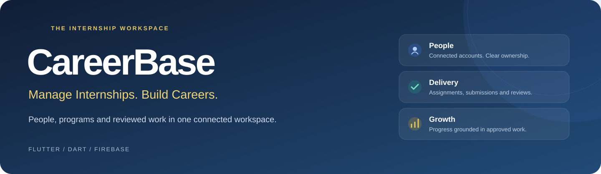

<br />


**A shared workspace for internship teams, from enrollment to reviewed outcomes.**

[Overview](#overview) · [App showcase](#app-showcase) · [Capabilities](#capabilities) · [Getting started](#getting-started) · [Validation](#validation)

</div>

## Overview

CareerBase brings internship administration and an intern's daily work into one Flutter application. Administrators organize programs, connect intern accounts, assign deliverables and review submissions. Interns follow their placement, complete assigned work and track feedback and approved progress.

The workspace combines role-based navigation, permanent enrollment identifiers, Firebase Authentication and real-time Cloud Firestore records. The interface uses a navy, blue and gold palette, with light and dark appearance and layouts for compact and wider screens.

## App showcase

Actual Android captures from CareerBase. The screenshots show an administrator workspace, including its initial empty states and management dialogs. Select an image to view the original resolution.

<table>
  <tr>
    <td align="center" width="33%">
      <a href="docs/screenshots/01-sign-in.png">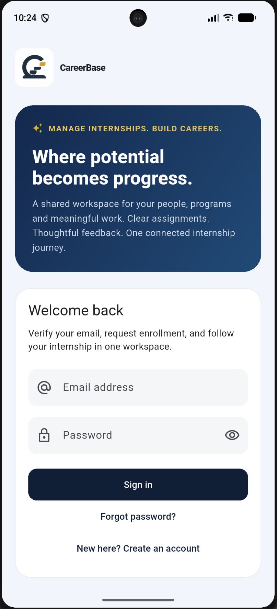</a>
      <br /><strong>Sign in</strong><br /><sub>Account access and enrollment entry</sub>
    </td>
    <td align="center" width="33%">
      <a href="docs/screenshots/02-admin-overview.png">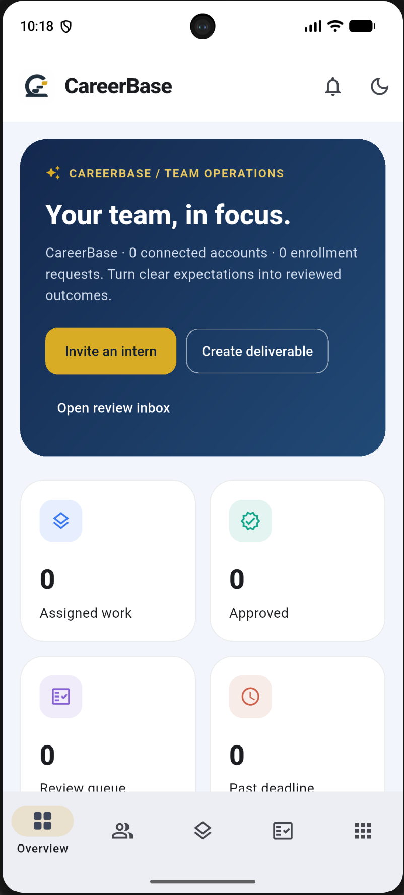</a>
      <br /><strong>Team overview</strong><br /><sub>Workload, approvals and deadlines</sub>
    </td>
    <td align="center" width="33%">
      <a href="docs/screenshots/08-deliverables.png">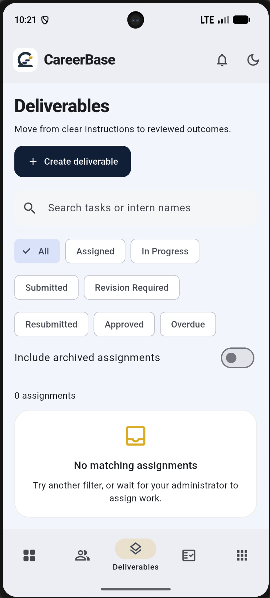</a>
      <br /><strong>Deliverables</strong><br /><sub>Search, stages and assignment filters</sub>
    </td>
  </tr>
</table>
### Explore the workspace

The galleries below follow the management journey: establish the workspace, enroll people, organize work, review outcomes and manage daily operations. All 19 supplied screenshots are included, with their original content and proportions preserved.

<details>
<summary><strong>01 · Dashboard detail & mobile navigation</strong></summary>

The delivery overview connects current work to team progress. The More menu keeps operational modules accessible on a compact screen.

<table>
  <tr>
    <td align="center" width="50%">
      <a href="docs/screenshots/03-dashboard-delivery.png">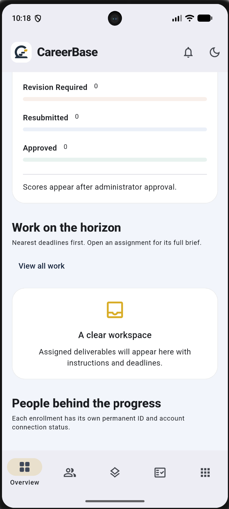</a>
      <br /><strong>Delivery overview</strong><br /><sub>Upcoming work and team performance</sub>
    </td>
    <td align="center" width="50%">
      <a href="docs/screenshots/19-workspace-navigation.png">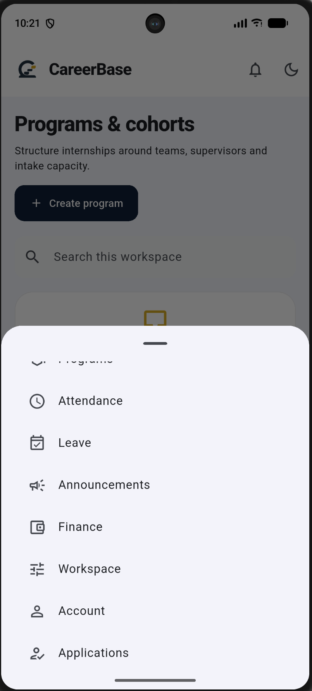</a>
      <br /><strong>Workspace navigation</strong><br /><sub>Operational modules from the More menu</sub>
    </td>
  </tr>
</table>
</details>

<details>
<summary><strong>02 · People, enrollment & program placement</strong></summary>

Manage profiles through a searchable directory, prepare enrollment using an account email, organize programs and review placement applications.

<table>
  <tr>
    <td align="center" width="50%">
      <a href="docs/screenshots/04-people-directory.png">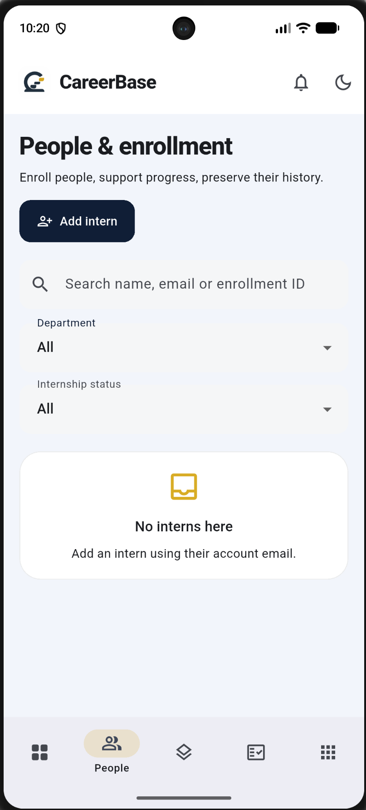</a>
      <br /><strong>People & enrollment</strong><br /><sub>Search and filter intern records</sub>
    </td>
    <td align="center" width="50%">
      <a href="docs/screenshots/05-intern-enrollment.png">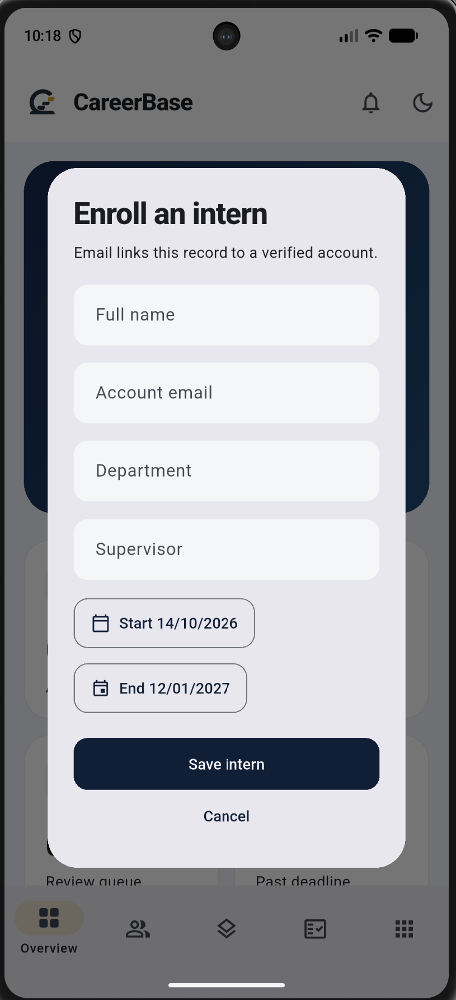</a>
      <br /><strong>Enroll an intern</strong><br /><sub>Email, department, supervisor and dates</sub>
    </td>
  </tr>
</table>

<table>
  <tr>
    <td align="center" width="50%">
      <a href="docs/screenshots/06-programs-cohorts.png">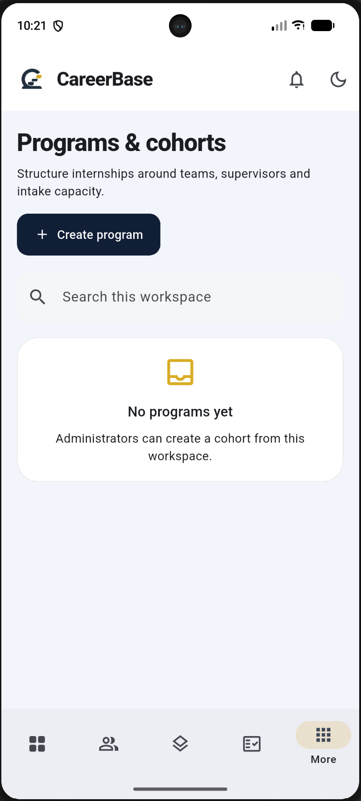</a>
      <br /><strong>Programs & cohorts</strong><br /><sub>Program directory and intake management</sub>
    </td>
    <td align="center" width="50%">
      <a href="docs/screenshots/07-program-applications.png">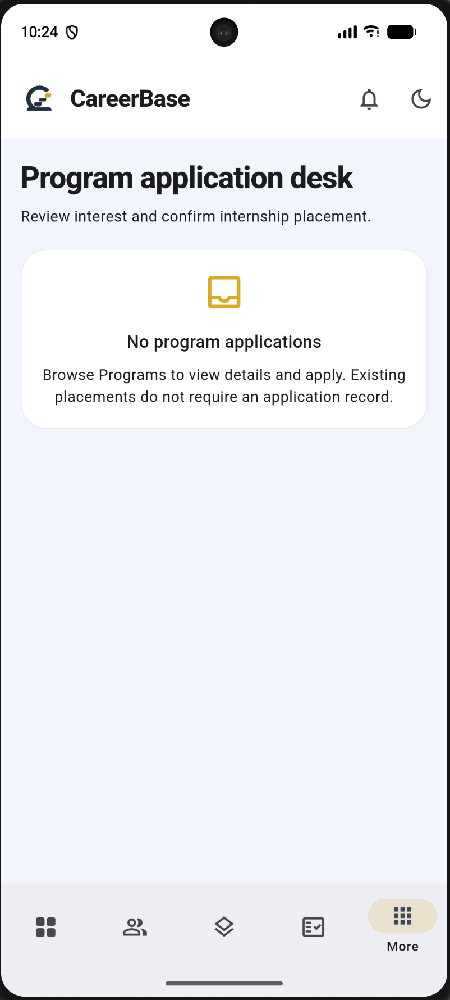</a>
      <br /><strong>Application desk</strong><br /><sub>Review interest and confirm placement</sub>
    </td>
  </tr>
</table>
</details>

<details>
<summary><strong>03 · Deliverable creation & submission reviews</strong></summary>

Create a deliverable with instructions, priority, reference links and a deadline. Submitted work enters a review queue; an empty queue is shown here because this capture contains no pending submissions.

<table>
  <tr>
    <td align="center" width="33%">
      <a href="docs/screenshots/09-create-deliverable.png">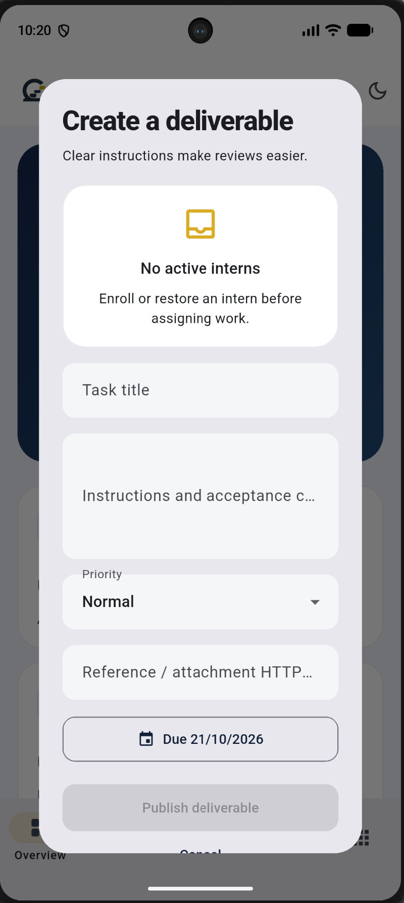</a>
      <br /><strong>Create a deliverable</strong><br /><sub>Assignment brief and deadline dialog</sub>
    </td>
    <td align="center" width="33%">
      <a href="docs/screenshots/10-review-inbox.png">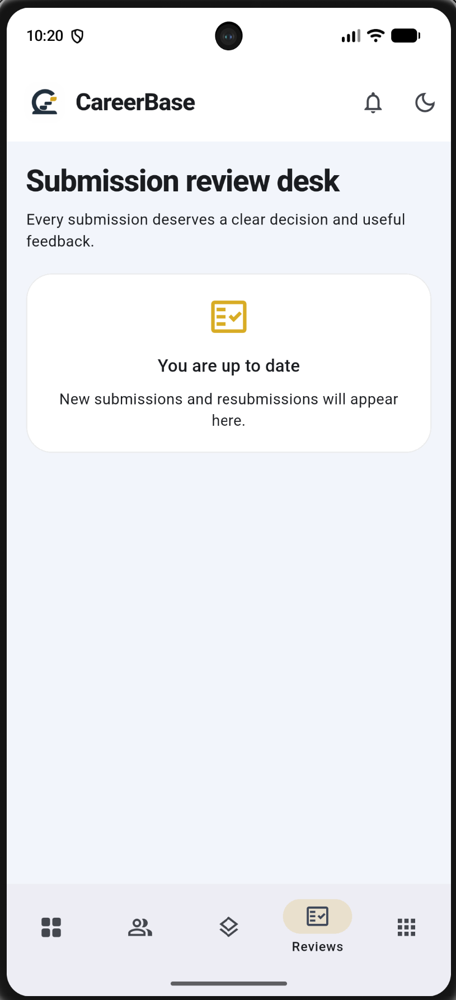</a>
      <br /><strong>Submission reviews</strong><br /><sub>A clear empty state when the queue is clear</sub>
    </td>
    <td align="center" width="33%">
      <a href="docs/screenshots/11-review-inbox-alternate.png">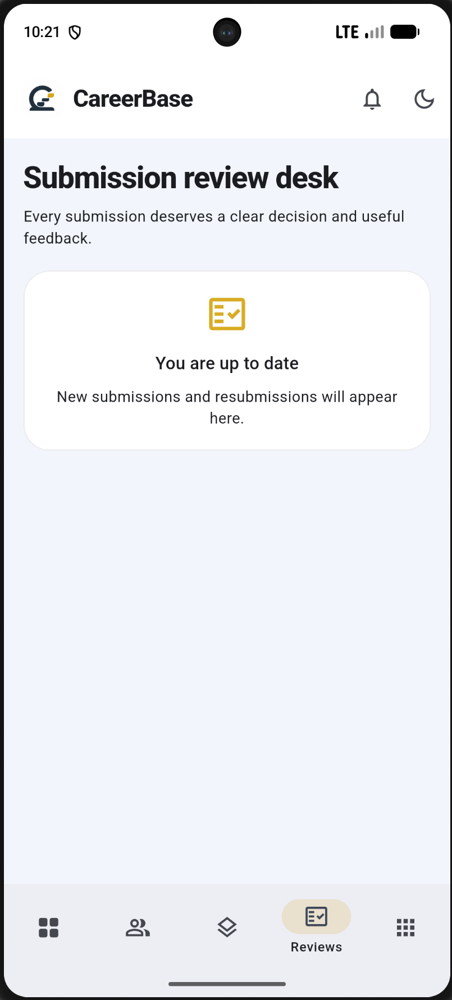</a>
      <br /><strong>Review navigation</strong><br /><sub>A second capture of the review destination</sub>
    </td>
  </tr>
</table>
</details>

<details>
<summary><strong>04 · Attendance, leave, announcements & stipends</strong></summary>

Keep day-to-day records alongside the work itself: presence, availability, workspace updates and stipend status.

<table>
  <tr>
    <td align="center" width="50%">
      <a href="docs/screenshots/12-attendance.png">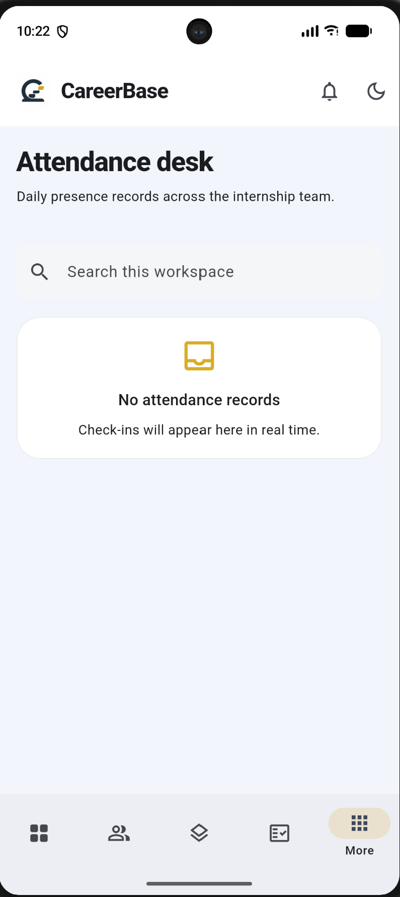</a>
      <br /><strong>Attendance desk</strong><br /><sub>Daily check-in and check-out records</sub>
    </td>
    <td align="center" width="50%">
      <a href="docs/screenshots/13-leave-availability.png">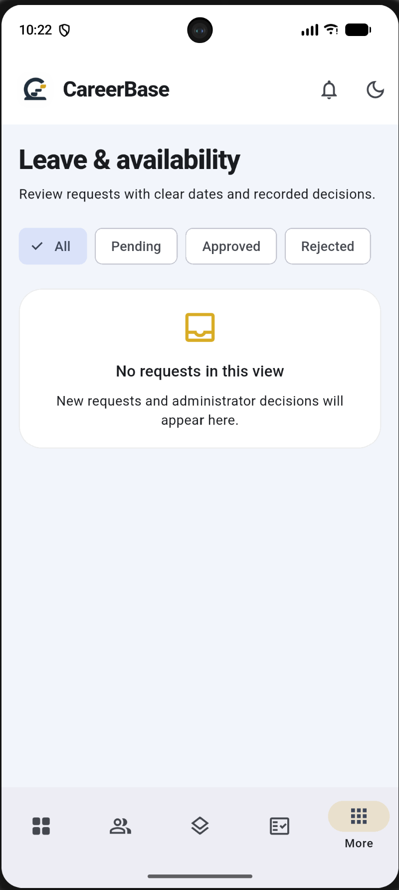</a>
      <br /><strong>Leave & availability</strong><br /><sub>Request status and decision filters</sub>
    </td>
  </tr>
</table>

<table>
  <tr>
    <td align="center" width="50%">
      <a href="docs/screenshots/14-announcements.png">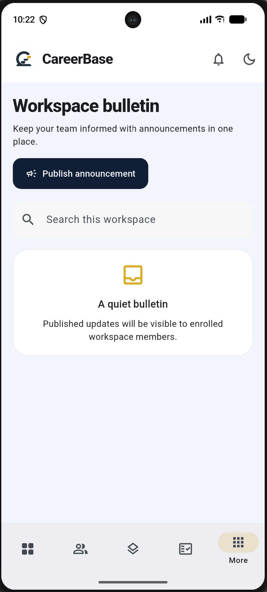</a>
      <br /><strong>Workspace bulletin</strong><br /><sub>Publish and manage team announcements</sub>
    </td>
    <td align="center" width="50%">
      <a href="docs/screenshots/15-stipend-ledger.png">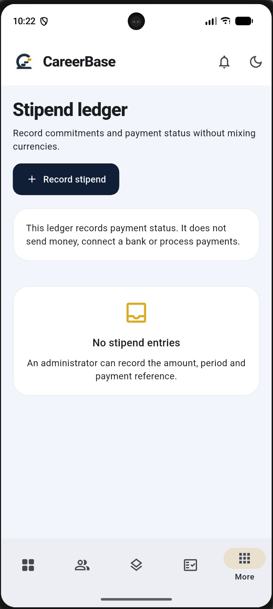</a>
      <br /><strong>Stipend ledger</strong><br /><sub>Record payment amounts and status</sub>
    </td>
  </tr>
</table>
</details>

<details>
<summary><strong>05 · Workspace identity, account controls & dark appearance</strong></summary>

Set the organization name and description from the application. Account controls include appearance, password reset, sign out and an administrator team report export.

<table>
  <tr>
    <td align="center" width="33%">
      <a href="docs/screenshots/16-workspace-settings.png">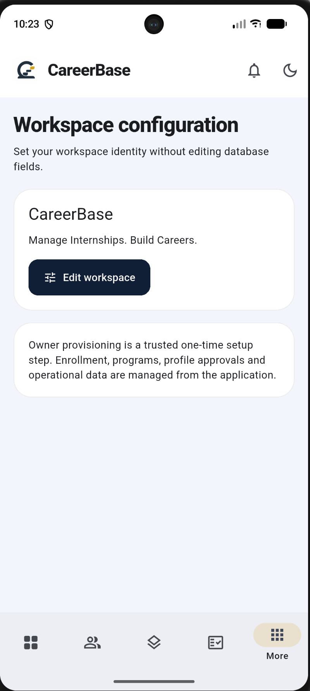</a>
      <br /><strong>Workspace settings</strong><br /><sub>Organization identity and configuration</sub>
    </td>
    <td align="center" width="33%">
      <a href="docs/screenshots/17-edit-workspace.png">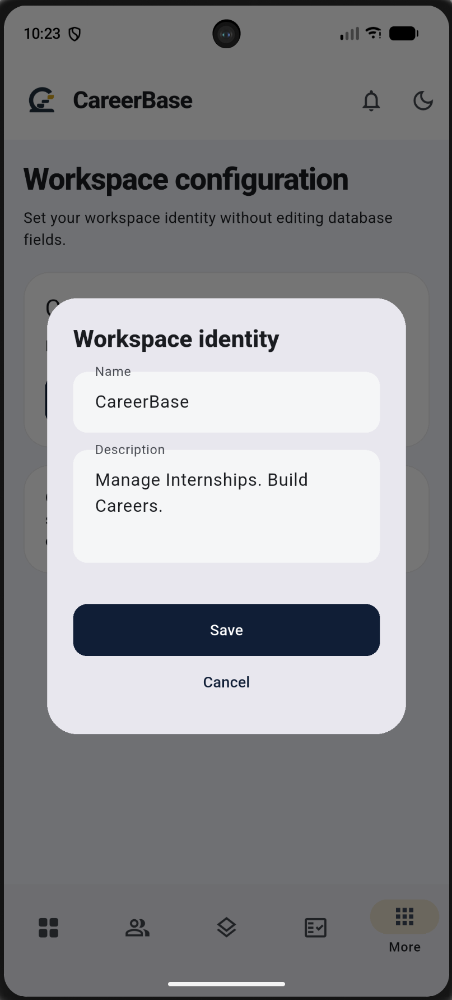</a>
      <br /><strong>Edit workspace</strong><br /><sub>Name and description editor</sub>
    </td>
    <td align="center" width="33%">
      <a href="docs/screenshots/18-account-dark-mode.png">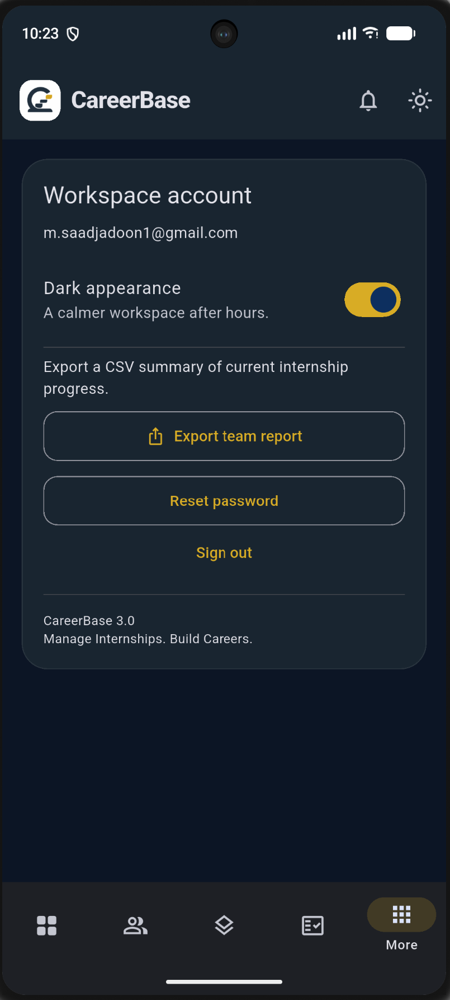</a>
      <br /><strong>Account in dark mode</strong><br /><sub>Appearance, export and account controls</sub>
    </td>
  </tr>
</table>
</details>

## Capabilities

| Area | Administrator workspace | Intern workspace |
| :--- | :--- | :--- |
| Accounts & enrollment | Prepare email-based enrollment, review profiles and manage activation | Register, verify email and connect or request enrollment |
| Identity | Search permanent enrollment IDs and inspect account connection status | View the enrollment associated with the signed-in account |
| Programs | Create and manage cohorts, supervisors, dates and capacity | Read program information and apply when unassigned |
| Deliverables | Create and edit assignments, set priorities and deadlines, archive work | View own assignments, start work and submit HTTPS work links with notes |
| Reviews | Approve with feedback and a score, or request revision | Read feedback, resubmit and inspect submission history |
| Progress | Inspect team workload, overdue work and approved outcomes | Follow personal completion and approved scores |
| Operations | Review attendance and leave, publish announcements, record stipends | Check in/out, request leave, read updates and view own stipend records |
| Profile & settings | Update workspace identity and export a team progress CSV | Edit personal details and profile photo |

### A complete review cycle

**Assigned → In Progress → Submitted → Approved**

When changes are needed: **Submitted → Revision Required → Resubmitted → Review**.

Submitting work does not approve it. Approval and feedback are administrator decisions, and completion is calculated from approved, non-archived assignments. Earlier submission attempts remain part of the work record.

### Identity and access

An administrator-created name is an enrollment record, not a connected account. The intern signs up using the matching email, verifies it and connects the enrollment. The profile distinguishes **Awaiting signup**, **Account connected** and **Pending approval**. Tasks reference the stored intern ID, so changing a display name does not change work ownership.

Firebase Authentication establishes account access; deployed Firestore rules enforce role and record permissions. Normal signup does not grant administrator access. Email verification confirms control of an email address, not legal identity or qualifications.

## Technology

| Layer | Implementation |
| :--- | :--- |
| Application | Flutter and Dart with Material components |
| Authentication | Firebase Authentication |
| Shared records | Cloud Firestore snapshot listeners |
| State | ChangeNotifier-based workspace store |
| Local demo | SharedPreferences-backed sample records |
| Profile photo | Image selection and compressed profile image data |
| Work evidence | HTTPS repository, demo and reference links |
| Reporting | CSV generation and platform sharing |

Firebase Storage and external AI or jobs APIs are not required for the core workflow. The stipend ledger records payment information; it does not transfer money.

## Getting started

Open a terminal in the repository root after cloning or downloading the project. Install Flutter with an Android toolchain and start a supported emulator or connect an Android device.

### 1. Resolve dependencies

```powershell
flutter doctor
flutter pub get
flutter devices
```

If your checkout does not yet contain the generated platform folders, use the included bootstrap script first:

```powershell
powershell -NoProfile -ExecutionPolicy Bypass -File .\scripts\bootstrap.ps1
```

### 2. Explore the local demo

```powershell
flutter run -d emulator-5554 --dart-define=DEMO=true
```

Replace `emulator-5554` with the device ID printed by `flutter devices`. Demo mode uses explicitly labelled local sample data and simulated role switching. It does not create or verify real Firebase accounts.

### 3. Connect your own Firebase workspace

Use a Firebase project you own. Enable Email/Password authentication and create a Cloud Firestore database. From the repository root:

```powershell
firebase login
dart pub global activate flutterfire_cli
dart pub global run flutterfire_cli:flutterfire configure --project=YOUR_FIREBASE_PROJECT_ID --platforms=android --android-package-name=com.saadi.careerbase
firebase deploy --only firestore --project YOUR_FIREBASE_PROJECT_ID
```

Replace `YOUR_FIREBASE_PROJECT_ID` with your actual project ID. Generated Firebase options must match the selected Android application. Keep an existing working Firebase configuration when applying source updates.

For the first administrator, follow the trusted owner provisioning instructions in `SETUP_OWNER.md`. After that, use the application to create programs, enroll interns, assign work and review submissions. The private Admin SDK credential belongs outside the repository and must never be bundled into the app.

Run with Firebase enabled:

```powershell
flutter run -d emulator-5554
```

Stop a running demo before switching modes. Verify the account email and complete the appropriate enrollment or owner setup before expecting workspace access.

## Validation

Run the checks against your checkout:

```powershell
dart format lib test scripts
flutter analyze
flutter test
flutter build apk --debug --dart-define=DEMO=true
```

The final command builds a **demo** APK. For a Firebase-connected debug build, configure Firebase and omit the demo flag:

```powershell
flutter build apk --debug
```

Included tests cover store workflows, review/resubmission guards, identity behavior, management operations and navigation at multiple screen sizes and text scales. Test files and screenshots are not a claim that every check has passed. Validate live enrollment, account permissions, assignment and review with separate administrator and intern accounts before using real data.

## Scope

CareerBase is a **single-organization internship workspace**. It does not currently provide government ID verification, automatic invitation emails, external internship listings, a separate project/milestone module, bank transfers or push notifications. Work evidence is shared through links. Attendance uses a Pakistan-time business date; program capacity and leave overlap have client-side guards rather than strict cross-record server quotas.

---

<div align="center">

**CareerBase**<br />
<sub>Manage Internships. Build Careers.</sub>

</div>
